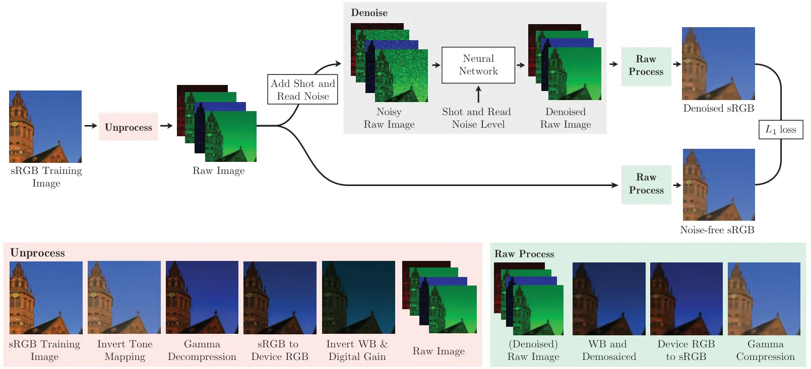
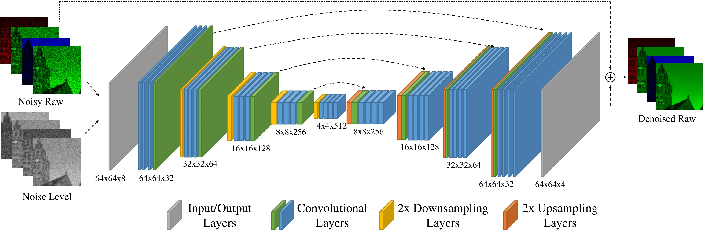
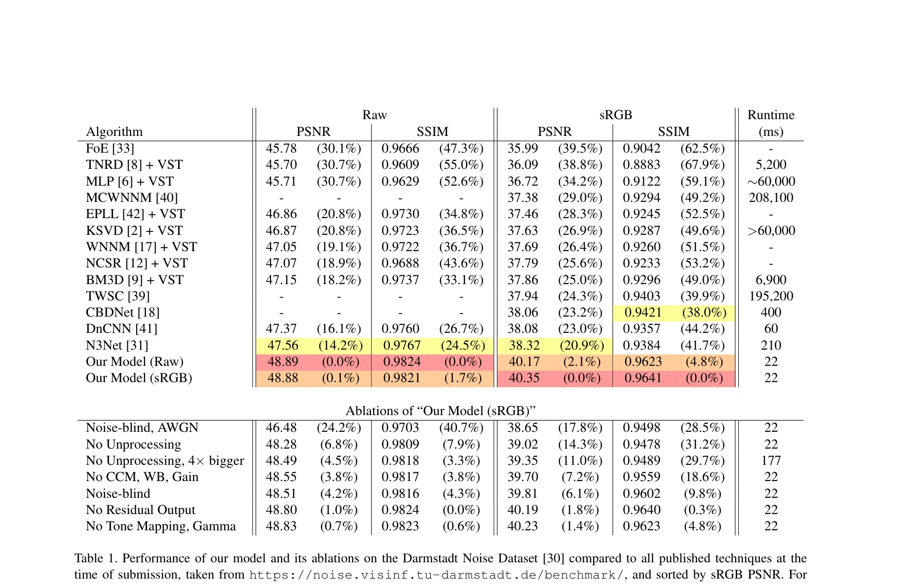

# Unprocessing Images for Learned Raw Denoising

- **来源**: https://arxiv.org/abs/1811.11127
- **本地PDF**: `../raw/2018-11-27-unprocessing.pdf`
- **本地LaTeX**: `../raw/2018-11-27-unprocessing-latex/`
- **参考链接**: https://openaccess.thecvf.com/content_CVPR_2019/papers/Brooks_Unprocessing_Images_for_Learned_Raw_Denoising_CVPR_2019_paper.pdf（CVPR 2019 camera-ready）；http://timothybrooks.com/tech/unprocessing（项目主页）；https://github.com/timothybrooks/unprocessing（官方代码）
- **公众号/知乎推文**: [论文解读: Unprocessing Images for Learned Raw Denoising](http://mp.weixin.qq.com/s?__biz=MzY5MDEyMjM1Ng==&mid=2247484297&idx=1&sn=b3a11028a1f05d9fc3a7e7ec8025e4b4)（微信公众号“Matrix Codex”；发布日期未显示）；[图像降噪之Unprocessing Images for Learned Raw Denoising](http://mp.weixin.qq.com/s?__biz=MjM5MzU2NzM5MA==&mid=2649667751&idx=1&sn=ddc08f204e90025fdc9f93c3829f0d6e)（微信公众号“信息网络工程研究中心”；发布日期未显示）；知乎未检索到
- **日期**: 2018-11-27
- **标签**: `unprocessing` `raw-denoising` `isp-inversion` `image-synthesis` `camera-pipeline` `cvpr2019` `darmstadt-dataset`
- **研究方向**: 计算摄影（Computational Photography）→ 图像去噪（Image Denoising）→ RAW 域去噪与合成训练数据生成
- **作者**: Tim Brooks, Ben Mildenhall, Tianfan Xue, Jiawen Chen, Dillon Sharlet, Jonathan T. Barron（Google Research；UC Berkeley）
- **提交日期**: 2018-11-27 (v1)
- **会议/期刊**: CVPR 2019
- **代码**: https://github.com/timothybrooks/unprocessing
- **项目主页**: http://timothybrooks.com/tech/unprocessing

---

## 摘要

**问题**: 机器学习方法在训练数据与评测数据分布一致时才表现最好。学习型单图去噪尤其如此：它实际运行在真实相机传感器的 RAW 读数上，却因数据获取困难，通常只能拿合成数据训练。已有工作关注传感器噪声特性，却常常忽略图像处理管线（Image Signal Processing，ISP）里的其他步骤，比如增益、颜色校正、色调映射，而这些步骤对 RAW 测量如何变成最终照片有巨大影响。

**方案**: 提出「unprocessing（逆处理）」技术，逐项反转相机 ISP 的每个步骤，从而把常见的互联网 sRGB 照片合成为逼真的 RAW 传感器测量。同时，在计算损失时也建模 ISP 的相关组件，让训练意识到去噪之后还会发生的光度处理。

**关键创新/贡献**：
- **创新点1（unprocessing）**: 反转色调映射、伽马压缩、颜色校正、白平衡、数字增益，把 sRGB 图退回到类 RAW 状态，再叠加现实噪声，合成「带噪/干净」训练对。
- **创新点2（processing-aware loss）**: 网络输出与干净真值都先过一遍正向 ISP（白平衡、去马赛克、颜色校正、伽马压缩）再算损失，让网络显式知道自己的输出之后会被怎样处理。
- **创新点3（现实噪声建模）**: 用 shot/read 噪声的异方差高斯模型，并从真实数据集的噪声参数分布里采样，替代不现实的加性高斯白噪声（AWGN）。
- **创新点4（简单网络即 SOTA）**: 用一个小型 U-Net，就取得 Darmstadt 数据集上前所未有的精度与速度。

**验证**: 在 Darmstadt Noise Dataset（50 张真实高 ISO 图像，隐藏真值，在线评测）上，比之前最优方法错误率低 **14%–38%**，速度快 **9×–18×**，且能泛化到该数据集之外的传感器（HDR+）。

---

## 1. 引言

**背景 & 动机**:
- 传统单图去噪用解析模型描述图像与噪声的先验；现代方法用神经网络学「带噪→干净」的映射，但训练需要大量成对数据。
- 大多数学习型去噪依赖合成训练数据，但近年基准（RENOIR、Darmstadt）显示，在真实带噪 RAW 图上，深度学习模型常被传统手工算法反超。
- 作者认为这种落差部分来自不现实的合成数据：经典算法假设噪声是加性白高斯（Additive White Gaussian Noise，AWGN），与真实成像物理不符；更精细的噪声模型只改进噪声，却没考虑 ISP 其余步骤。
- 另一条路是拍真实「带噪/干净」配对数据（SIDD、chen 等），但采集费时费力，且换传感器就得重新采集，难以适配新相机。

**本文贡献**:
1. 提出系统建模 ISP 关键步骤、把通用互联网图「unprocess」成逼真 RAW 数据的方法。
2. 把常规图像处理操作直接纳入神经网络训练，让网络对「输出之后如何被处理」有感知。
3. 在 Darmstadt 上实现 14%–38% 更低错误率、9×–18× 更快推理，并泛化到未建模的设备。

**论文结构**: §2 相关工作；§3 RAW 图像管线及每步的逆；§4 合成 RAW 数据、损失改造与网络模型；§5 结果与消融。

---

## 2. 相关工作

- **经典去噪**: 各向异性扩散、全变分（TV）、小波阈值，假设信号与噪声有特定统计规律。
- **非参数/自相似**: BM3D、非局部均值（Non-local Means），利用块相似性。
- **字典学习/稀疏**: KSVD、Fields-of-Experts，寻找稀疏或统计规律良好的表示。
- **现代深度网络**: 从带噪图回归到干净图。
- **噪声建模**: 多数经典工作假设 AWGN；更准确的模型把噪声看成 shot（泊松）与 read（高斯）分量，或用方差随强度变化的异方差高斯。
- **真实配对数据**: RENOIR、Darmstadt 提供短曝光（带噪）与长曝光（近似干净）配对；SIDD、chen 等用它训练。问题在于逐相机采集成本高，且对水、云、树叶、活物等易动内容难以拍到严格对齐的配对。
- **Noise2Noise**: 用同一场景多张带噪图训练，缓解配对需求，但没有根本消除大采集的负担。
- **本文定位**: 噪声建模之外，补上 ISP 处理链路的建模与反转。

---

## 3. RAW 图像管线

现代相机的 RAW 数据并不像照片，需要多个处理阶段才能从带噪的线性强度变成最终图像。本节描述一个常规 ISP（从传感器测量到成片），并给出每步的逆，以便把互联网图变成逼近 Darmstadt 分布的合成 RAW。整体流程见下方数据管线图。

### 3.1 散粒噪声与读出噪声（Shot and Read Noise）

RAW 域的噪声来源清晰，主要两类：光子到达统计的 **shot 噪声**（泊松，均值等于真实光强）与读出电路的 **read 噪声**（近似零均值高斯，方差固定）。两者可合并成一个异方差高斯，把观测强度 $y$ 建模为方差随真实信号 $x$ 变化的随机量：

$$
y \sim \mathcal N\left(\mu=x,\ \sigma^{2}=\lambda_{\text{read}} + \lambda_{\text{shot}} x\right).
$$

参数 $\lambda_{\text{read}}$ 与 $\lambda_{\text{shot}}$ 由传感器的模拟增益与数字增益决定。对数字增益 $g_d$、模拟增益 $g_a$、固定读出方差 $\sigma_r^2$：

$$
\lambda_{\text{read}} = g_d^2\,\sigma_r^{2},\qquad \lambda_{\text{shot}} = g_d\,g_a.
$$

这两个增益由相机随 ISO 或自动曝光设定，因此噪声参数可由相机算好并写进 RAW 元数据。合成数据时，作者对真实 RAW 的 shot/read 参数对建模联合分布并从中采样。对 Darmstadt，一个合理的采样方式是：

$$
\log \lambda_{\text{shot}} \sim \mathcal U\left(\log 0.0001,\ \log 0.012\right),
$$

$$
\log \lambda_{\text{read}} \mid \log \lambda_{\text{shot}} \sim \mathcal N\left(\mu=2.18\,\log \lambda_{\text{shot}} + 1.2,\ \sigma=0.26\right).
$$

### 3.2 去马赛克（Demosaicing）

传感器每个像素只被一个红、绿或蓝滤色片覆盖，通常按 Bayer 排列（如 R-G-G-B）。去马赛克是从每像素单色恢复三色。Darmstadt 用双线性插值，本文沿用。逆操作很直接：对每个像素，按 Bayer 模式丢弃三色中的两色。

### 3.3 数字增益（Digital Gain）

相机常对所有强度施加一个由自动曝光选出的数字增益。自动曝光算法是黑盒，难以逐图反推。逆操作用一个全局缩放，去匹配真实与合成数据集的边际强度统计。假设两边的强度都服从指数分布：

$$
p(x;\lambda)=\lambda\, e^{-\lambda x}.
$$

尺度参数 $\lambda$ 的极大似然估计是样本均值的倒数，缩放强度等价于反向缩放 $\lambda$。因此用两个数据集样本均值之比即可对齐，Darmstadt 与合成数据的缩放比是 **1.25**。为了更充分的增广、并让模型看到 $[0,1]$ 全范围强度，作者不从常数 1.25 缩，而是从均值为 $1/1.25=0.8$、标准差 $0.1$ 的正态分布采样逆增益，逆增益大致落在 $[0.5,1.1]$。

### 3.4 白平衡（White Balance）

相机的目标是抵消光照颜色，让照片看起来像在「中性」光下拍的。白平衡算法估计红蓝通道各自的增益。逆操作同样受限于算法不可知，因此从 Darmstadt 记录的白平衡增益经验分布里采样：红增益在 $[1.9,2.4]$、蓝增益在 $[1.5,1.9]$，独立均匀采样。

合成时把逆数字增益与逆白平衡增益相乘，得到逐通道逆增益。该逆增益通常小于 1，直接增益下调会系统性丢失高光、几乎没有饱和像素，这对去噪很重要。于是作者不简单做乘法，而是用一个保高光变换 $f(x,g)$：当 $g\le 1$ 或 $x\le t$（阈值 $t=0.9$）时保持线性，当 $g>1$ 且 $x>t$ 时用三次变换平滑过渡：

$$
\alpha(x)=\left(\frac{\max(x-t,\,0)}{1-t}\right)^{2},
$$

$$
f(x,g)=\max\left(\frac{x}{g},\ \left(1-\alpha(x)\right)\frac{x}{g}+\alpha(x)\,x\right).
$$

该函数满足 $x\le t$ 时 $f(x,g)=x/g$，且 $f(1,g)=1$（当 $g\le 1$），并连续可微。

### 3.5 颜色校正（Color Correction）

传感器滤色片的响应一般不匹配 sRGB 光谱，相机会用 3×3 颜色校正矩阵（Color Correction Matrix，CCM）把「相机空间」RGB 转到 sRGB。Darmstadt 含四台相机，各用一个固定 CCM。合成时作者对这四个 CCM 做随机凸组合，再对每张合成图应用采样 CCM 的逆。

### 3.6 伽马压缩（Gamma Compression）

人眼对暗部渐变更敏感，故用伽马压缩把更多动态范围比特分配给低强度像素。作者用与 Darmstadt 相同的标准伽马曲线，并在输入处以 $\epsilon=10^{-8}$ 截断防止训练数值不稳定：

$$
\Gamma(x)=\max(x,\epsilon)^{1/2.2}.
$$

合成时应用其近似逆（因 $\epsilon$ 而略有近似）：

$$
\Gamma^{-1}(y)=\max(y,\epsilon)^{2.2}.
$$

### 3.7 色调映射（Tone Mapping）

高动态范围图像需要极端色调映射，普通低动态范围图像也常用 S 形曲线匹配胶片的「特性曲线」。更复杂的边缘感知局部色调映射难以反推，作者因此假设色调映射是简单 smoothstep 曲线，并在合成时用其逆：

$$
\operatorname{smoothstep}(x)=3x^{2}-2x^{3},
$$

$$
\operatorname{smoothstep}^{-1}(y)=\frac{1}{2}-\sin\left(\frac{\sin^{-1}(1-2y)}{3}\right),
$$

两者只在 $[0,1]$ 上有定义。

---

## 4. 模型

定义好管线每步及其逆之后，就可以构建去噪网络。训练输入是无噪真值经 unprocessing 后叠加噪声的合成带噪图，网络输出与干净真值在计算损失前都要再过一遍正向 processing。下图给出完整数据管线与训练流程。

*图 1：数据管线与训练流程。来自 MIR Flickr 的 sRGB 图被逆处理，加入现实 shot/read 噪声合成带噪 RAW 输入；网络输出与无噪 RAW 再过一遍正向处理才计算 L1 损失（论文 Figure 2）。*

### 4.1 逆处理训练图像（Unprocessing Training Images）

为生成逼真合成 RAW，按顺序反转：色调映射逆（§3.7）→ 伽马反压缩（§3.6）→ sRGB 到相机 RGB 的 CCM（§3.5）→ 白平衡增益逆（§3.4）→ 数字增益逆（§3.3）。结果作为无噪真值，再叠加 shot/read 噪声（§3.1）得到带噪输入。这样合成的 RAW 强度分布与真实 RAW 更接近。

### 4.2 正向处理 RAW 图像（Processing Raw Images）

RAW 最终要被 ISP 处理后才被观看，因此模型输出也应先过处理再算损失。正向处理顺序是：白平衡增益 → 双线性去马赛克 → CCM（相机 RGB→sRGB）→ 伽马压缩。这个简化管线与 Darmstadt 基准一致，也是通用管线的良好近似。网络输出与干净真值都先过这一处理再算损失，让网络能推理下游处理对去噪结果的影响。

### 4.3 网络架构（Architecture）

网络输入是 Bayer 域的带噪 RAW，输出同域的降噪图。额外输入是每像素噪声标准差的估计，拼成 4 个额外通道（对应 R-G-G-B 四个 Bayer 平面）。网络用带 skip connection 的 U-Net，编码端 box 下采样、解码端双线性上采样，激活用 PReLU。与先前工作一致，模型预测残差再与输入相加，而非直接预测干净图。

*图 2：去噪网络结构。输入为 4 通道带噪 Bayer 马赛克拼接 4 通道噪声水平图，输出为 4 通道去噪马赛克（论文 Figure 5）。*

### 4.4 训练（Training）

合成数据来自 MIR Flickr extended 的 1M 张图，划出 5% 验证、5% 测试。所有图像用高斯核（$\sigma=1$）2× 下采样，以减少噪声、量化、JPEG 压缩、去马赛克等伪影。取随机 128×128 裁剪，加随机水平与垂直翻转增广。训练用 Adam，学习率 $10^{-4}$，$\beta_1=0.9$，$\beta_2=0.999$，$\epsilon=10^{-7}$，batch size 16。模型与消融训练约 3.5M 步，单张 NVIDIA Tesla P100 上约 3 天。

作者训练两个模型：一个针对 sRGB 误差指标，网络输出与合成真值都先转到 sRGB 再算损失；另一个「Raw」模型直接在网络输出与 RAW 真值之间算损失。两者都最小化 L1 损失。

---

## 5. 实验结果

评测用 Darmstadt Noise Dataset：50 张真实高分辨率图，每张带噪高 ISO 图配一张近似无噪的低 ISO 真值。它包含四台消费相机、自然场景、标定好的噪声特性，强度以线性 RAW 给出；真值完全隐藏，在线提交且限频，难以过拟合。主结果与消融见下表。

*表 1：Darmstadt 噪声数据集上的主结果与消融（论文 Table 1）。Raw 与 sRGB 各报 PSNR、SSIM，括号内为相对最优模型的误差降低率；下方子表为「Our Model (sRGB)」的消融。*

两个模型变体在所有输出上都明显超过所有基线：Raw 模型在 Raw 指标上最好，sRGB 模型在 sRGB 指标上最好。相对改进通过把 PSNR 转成 RMSE、SSIM 转成 DSSIM 后算误差降低率得到。

**主结果关键数字**（见 Table 1）:
- **Our Model (Raw)**: Raw PSNR **48.89** / SSIM **0.9824**，sRGB PSNR 40.17 / SSIM 0.9623。
- **Our Model (sRGB)**: Raw PSNR 48.88 / SSIM 0.9821，sRGB PSNR **40.35** / SSIM **0.9641**。
- 此前最优 N3Net: Raw PSNR 47.56 / SSIM 0.9767，sRGB PSNR 38.32 / SSIM 0.9384。
- 相对 N3Net，本文在两项 Raw 指标上误差降低 **14%** 与 **25%**；相对 N3Net 与 CBDNet，在两项 sRGB 指标上误差降低 **21%** 与 **38%**。
- 改进部分来自输出中更少的低频色度伪影。

**消融（对「Our Model (sRGB)」逐项移除）**（见 Table 1 下方子表）:
- **Noise-blind, AWGN**（用 $\sigma\sim U(0.001,0.15)$ 的加性高斯噪声替代现实噪声）掉点最严重，sRGB PSNR 降到 38.65，说明噪声建模最敏感。
- **No Unprocessing**（完全不做逆处理）sRGB PSNR 39.02，掉 1.33。
- **No Unprocessing, 4× bigger**（去掉逆处理但通道数×4）sRGB PSNR 39.35，仍明显低于完整模型，说明增大网络无法弥补逆处理的缺失。
- **No CCM, WB, Gain** sRGB PSNR 39.70、**Noise-blind** 39.81、**No Residual Output** 40.19、**No Tone Mapping, Gamma** 40.23，去掉任一项都会降低质量。
- 唯一架构层面的消融「No Residual Output」掉点最小。

**泛化**: 在 HDR+ 数据集的真实 RAW 上验证，说明方法可泛化到未显式建模的设备（见论文 Figure 6 与补充材料）。

### 5.1 运行时间（Runtimes）

Table 1 还列出各方法的运行时间。本文模型对 Darmstadt 512×512 图耗时 **22ms**（TensorFlow，单张 GTX 1080Ti，不含 GPU 传输时间，100 次均值）。对比：N3Net 约 210ms，CBDNet 400ms，DnCNN 60ms。本文模型是显著最快的方法，比 N3Net 快 **9×**，比 CBDNet 快 **18×**。

---

## 6. 结论

**总结**: 作者提出 unprocessing 技术，通过建模并反转相机 ISP 每步，把通用互联网图变成贴近真实传感器 RAW 的合成数据，从而从海量现成图像里合成大量逼真的带噪/干净配对训练数据。进一步把标准图像处理操作纳入训练过程，让网络显式知道输出之后会被如何处理。最终在 Darmstadt 上取得 14%–38% 更低错误率、9×–18× 更快推理。

**局限**: 论文未设专门小节，但从方法设计可归纳：
- 假设色调映射是简单 smoothstep，未处理更复杂的边缘感知局部色调映射（作者明言这类操作难以反推）。
- 白平衡、数字增益依赖目标数据集的经验分布，换相机时可能需要重新拟合分布。
- 噪声模型是异方差高斯近似，未覆盖某些传感器特有的噪声来源。
- 逆处理本质是「近似反转」，无法完美还原真实 RAW 的强度与颜色分布。

---

## 本文涉及到的模型具体结构

| 模块 | 结构 | 说明 |
|---|---|---|
| 输入 | 4 通道带噪 Bayer + 4 通道噪声水平图 | 共 8 通道；噪声水平图按 R-G-G-B 平面逐像素给出 |
| 骨干 | U-Net + skip connection | 编码端下采样、解码端上采样 |
| 下采样 | box downsampling（论文）| 官方代码用 2×2 max pooling，见 Q&A |
| 上采样 | 双线性插值（bilinear）| 与论文一致 |
| 激活 | PReLU（论文）| 官方代码用 leaky ReLU（固定斜率），见 Q&A |
| 输出 | 4 通道残差 + 输入 | 残差学习，最终 4 通道去噪 Bayer |
| 编码通道 | 32 → 64 → 128 → 256 | 瓶颈 512；解码 256 → 128 → 64 → 32 |
| 损失 | L1 | sRGB 模型过正向 ISP 再算，Raw 模型直接算 |

---

## 实验的全部流程

### 数据准备（合成阶段）
1. 取 MIR Flickr extended 1M 张 sRGB 图，5% 验证、5% 测试。
2. 高斯核（$\sigma=1$）2× 下采样，缓解 JPEG/量化/去马赛克伪影。
3. 随机 128×128 裁剪 + 水平/垂直翻转增广。
4. 按 §3 逐项反转：色调映射逆 → 伽马反压缩 → sRGB→相机 CCM → 白平衡逆 → 数字增益逆（含保高光变换）。
5. 从真实参数分布采样 shot/read 噪声，按 $\sigma^2=\lambda_{\text{read}}+\lambda_{\text{shot}} x$ 叠加到干净 RAW，得到带噪输入。

### 训练阶段
6. 网络输入 8 通道（带噪 Bayer + 噪声水平图）。
7. 前向得到去噪残差，加回输入。
8. sRGB 模型把输出与真值都过正向 ISP（白平衡→去马赛克→CCM→伽马压缩）再算 L1；Raw 模型直接算 L1。
9. Adam（lr 1e-4，batch 16）训练约 3.5M 步，单 P100 约 3 天。

### 测试阶段
10. 在 Darmstadt 50 张真实图（隐藏真值）在线评测，报告 Raw/sRGB 的 PSNR 与 SSIM。
11. 在 HDR+ 上做跨设备泛化验证。
12. 消融逐项移除逆处理、噪声模型、残差输出，衡量每项贡献。

---

## 个人评价

**核心价值**: 这篇论文的贡献不在网络结构，而在**训练数据与损失函数的分布对齐**。它指出学习型去噪在真实 RAW 上翻车的根因是「合成数据不像真实 RAW」，并给出了一整套可复用的解法：把 ISP 反过来做 unprocessing 造数据，把 ISP 正向做进 loss。这一「逆 ISP + 正向 loss」思路成了后续 RAW 域低层视觉（去噪、超分、HDR）数据合成的标准范式，直到今天仍被广泛引用。

**可借鉴点**:
- **数据分布对齐优先于模型复杂度**：本文用最朴素的 U-Net 就拿下 SOTA，说明在低层视觉里「数据像不像真的」往往比「网络多深多宽」更关键。
- **把评测链路做进训练**：损失前过一遍 ISP，等价于让网络优化最终用户看到的 sRGB，而不是中间 RAW。任何「输出之后还有后处理」的任务都可以借鉴这个「process-aware loss」。
- **噪声按物理建模并拟合真实分布**：shot+read 异方差高斯 + 从真实数据集采样参数，比拍脑袋设 AWGN 强度有效得多。换传感器时只需重新拟合噪声参数分布。
- **保高光变换**：增益下调时平滑保留饱和像素，是一个很实用的小技巧，避免合成数据系统性缺高光。
- **消融设计干净**：逐项去掉逆处理步骤 + 「4× 更大网络也补不回 unprocessing」的对比，把「数据质量」与「模型容量」的贡献切分开。

**实验设计亮点**:
- 用 Darmstadt 这种真值隐藏、限频在线评测的基准，避免过拟合测试集，结论可信。
- 同时报 Raw 与 sRGB 两组 PSNR/SSIM，并区分 Raw 模型与 sRGB 模型，说清各自优化目标。
- 用 RMSE/DSSIM 换算误差降低率，避免 PSNR/SSIM 饱和时相对差距被低估。
- 报告运行时间并说明测量口径（GPU、是否含传输），让 9×–18× 加速可复核。

---

## 疑问解答 (Q&A)

### Q1: 本论文去噪的是 RAW 还是 sRGB？此前的合成训练数据在哪个域加噪声？

**答（去噪域）**：**去噪动作发生在 RAW 域，但监督信号可以落在 sRGB 域**，两者不矛盾，需分开看。网络输入输出都是 RAW（4 通道 Bayer 马赛克 + 4 通道噪声水平图），所以「去噪本身」是 RAW 域单图去噪。论文训练了两个变体，网络结构完全相同，差别只在损失：

- **Our Model (Raw)**：网络输出与干净 RAW 真值直接算 L1，优化目标是 RAW。
- **Our Model (sRGB)**：输出与真值都先过一遍正向 ISP（白平衡 → 去马赛克 → CCM → 伽马），再在 sRGB 上算 L1，优化目标是用户最终看到的图。

论文没有「把网络放到 sRGB 图上跑」的变体；评测时 Raw 与 sRGB 两组指标都报（Table 1）。之所以选 RAW 做去噪：RAW 噪声是方差随强度线性变化的异方差高斯（shot 泊松 + read 高斯），建模容易；sRGB 图已过增益、去马赛克、颜色校正、伽马等非线性处理，噪声被扭曲、通道间相关，更难建模。

**答（旧合成数据的加噪域）**：主流做法是**在 sRGB 图上直接加噪声**（且常是最简单的 AWGN，如本论文消融里 $\sigma\sim U(0.001,0.15)$），再把它当作「模拟的带噪 RAW」来训练。这带来两处错配：一是**加噪的域错**，sRGB 已被 ISP 非线性处理，其上加的噪声不是 RAW 噪声；二是**干净图的分布也错**，sRGB 的强度分布、饱和像素比例、通道相关性都不像真实 RAW 的干净帧。本文的修正是：先把 sRGB 图 unprocess 回类 RAW 状态得到干净 RAW，**再在 RAW 域**叠加 shot/read 异方差高斯噪声（§3.1、§4.1）。消融中「No Unprocessing」掉 1.33 dB、「Noise-blind, AWGN」掉 1.70 dB，分别对应这两处错配的代价。也有少数工作在真实 RAW 上取干净帧再加噪，但受限于干净 RAW 库的规模与多样性，未成主流。

### Q2: 完整的 ISP 处理流程是什么？不同相机、摄像头是否流程不同？

**答（全链路）**：从曝光到落盘，按信号流排序：

1. 光学：镜头 → 光圈 → 快门（曝光时间）→ 红外截止/低通滤光片 → CFA（多为 Bayer R-G-G-B）。
2. 感光：光电二极管把光子转电子，曝光时间内积分（受量子效率与满阱容量约束 → 饱和/裁剪）。
3. 模拟前端：电荷→电压、模拟增益（ISO 的模拟部分）、相关双采样（CDS）抑制复位噪声。
4. ADC：量化成 12/14 bit 数字值。
5. 黑电平扣除、坏点校正、镜头阴影校正（LSC）——RAW 文件大致到这一步为止。
6. 数字增益（ISO 的数字部分 / 自动曝光策略）。
7. 白平衡增益。
8. 去马赛克。
9. 颜色校正矩阵 CCM（相机 RGB → sRGB/XYZ）。
10. 伽马压缩 + 色调曲线（厂商「色彩科学」的主要差异来源）。
11. 色域映射、饱和度、对比度、局部（边缘感知）色调映射。
12. 降噪（时域 + 空域）、锐化、边缘增强。
13. 多帧 HDR 合成、分区（天空/人脸）处理（现代手机）。
14. 压缩编码（JPEG/HEIF/H.264）→ 落盘。

本论文只建模第 5 步之前（RAW）与第 6–10 步（简化 ISP，见 §3），第 11 步之后一律不管。

**答（设备差异）**：**不同设备差异很大**，这正是本文必须按数据集拟合经验分布、且跨设备只能算「泛化」的原因：

- CFA 排列不同（Bayer 各排列、富士 X-Trans、手机 Quad-Bayer/RYYB）。
- CCM 需逐机标定（论文用 Darmstadt 四台相机的 CCM 做随机凸组合采样）。
- 色调曲线不同，即各家色彩科学差异。
- 黑电平与噪声参数 $\lambda_{\text{shot}}$、$\lambda_{\text{read}}$ 随传感器和 ISO 变化。
- RAW 格式不同：有损/无损压缩、是否已去马赛克、是否在 RAW 里就做了降噪。
- **监控摄像头**：ISP 链路结构相同（SoC 内含黑电平、LSC、白平衡、去马赛克、CCM、伽马、降噪、编码），但取舍不同——追求可辨识、低码率、低照度而非「好看」，常开强时域 3DNR、宽动态 WDR 多曝光合成、IR-cut 日夜切换与激进对比度拉伸，噪声里还有固定模式噪声与行噪声，且多数设备不导出 RAW。直接套用本文方法需重标噪声参数、确认数据是否已被 3DNR 处理过、并把 WDR 多曝光纳入建模。

### Q3: unprocessing 和 processing 分别解决什么问题？

**答**：unprocessing 解决**数据端**问题，把普通 sRGB 图反转回类 RAW 状态，用于合成逼真的训练真值；processing 解决**损失端**问题，把网络输出和真值再走一遍正向 ISP，让损失落在最终可见的 sRGB 上，而不是中间 RAW 上。两者一个造数据、一个定损失，方向相反、作用互补。

### Q4: 为什么消融里把现实噪声换成 AWGN 掉点最严重？

**答**：因为噪声是去噪任务的核心监督信号。AWGN 假设噪声与信号无关、处处同方差，而真实 RAW 噪声是 shot（信号相关、泊松）+ read（信号无关、高斯）的异方差高斯，暗部与亮部方差不同。用 AWGN 训练，模型学到的是错误的噪声先验，到真实图上的失配最大。消融中 sRGB PSNR 从 40.35 掉到 38.65，是所有单项里最严重的。

### Q5: 保高光变换 $f(x,g)$ 为什么必要？

**答**：合成时应用的逆增益通常小于 1，简单除法会让高光强度系统性降低，导致合成数据几乎没有饱和像素。真实 RAW 里饱和（clipped）像素是常见且需要正确处理的现象。$f(x,g)$ 在 $x\le 0.9$ 时保持线性，接近 1 时用三次项平滑过渡，保证 $f(1,g)=1$，从而在增益下调时保住高光与饱和像素。

### Q6: 为什么损失也要过一遍 ISP？

**答**：用户最终看到的是 sRGB 图，不是 RAW。如果把损失直接放在 RAW 上，网络会去优化一个「中间表示」的误差；而 RAW 到 sRGB 之间还有白平衡、去马赛克、颜色校正、伽马等光度变换，这些会改变误差的相对权重。把输出与真值都过一遍 ISP 再算 L1，网络就显式知道哪些 RAW 误差在最终图像上更显眼，从而优化真正被感知的质量。

### Q7: Raw 模型和 sRGB 模型有什么区别？

**答**：差别只在损失。sRGB 模型把网络输出与真值都转到 sRGB 再算 L1，因此在 sRGB 指标上最好；Raw 模型直接在 RAW 上算 L1，因此在 Raw 指标上最好。两者网络结构相同，只是监督目标不同，各在自己针对的域上超过对方。

### Q8: 官方代码与论文有哪些不一致？

**答**：对照 `timothybrooks/unprocessing` 仓库，有几处轻微不一致，都在网络实现上：
- 论文写激活为 PReLU（可学习斜率），代码 `network.py` 默认用 leaky ReLU（固定斜率）。
- 论文写编码端「box downsampling」，代码用 2×2 max pooling。
- 论文写学习率 $10^{-4}$，代码 `train.py` 的默认 flag 是 2e-5。
- 论文写网络输入是「噪声标准差」的估计，代码 `dataset.py` 实际算并传入的是 `variance = shot_noise * noisy_img + read_noise`（方差而非标准差）。
- 论文写训练裁剪 128×128，代码默认 `image_size=256`。

这些不影响方法结论，但复现时需注意默认配置与论文表项可能不同。

### Q9: 方法如何泛化到未建模的相机？

**答**：作者在 HDR+ 数据集的真实 RAW 上做了验证，说明即便合成数据只按 Darmstadt 的噪声与 CCM 分布拟合，去噪网络仍能处理其他设备。原因在于 unprocessing 建模的是通用 ISP 结构，且噪声参数覆盖了一个较宽的范围。若要让某台相机表现最佳，README 建议按该相机的元数据重拟合 `random_ccm()`、`random_gains()`、`random_noise_levels()`。

### Q10: 主要局限是什么？

**答**：论文未设专门局限小节，但从方法可归纳：假设色调映射是简单 smoothstep，未覆盖复杂局部色调映射；白平衡与数字增益依赖目标数据集经验分布，换相机需重新拟合；噪声模型是异方差高斯近似，未覆盖所有传感器噪声源；unprocessing 是近似反转，无法完美还原真实 RAW。

---

## 相关推文（微信公众号/知乎）

- [论文解读: Unprocessing Images for Learned Raw Denoising](http://mp.weixin.qq.com/s?__biz=MzY5MDEyMjM1Ng==&mid=2247484297&idx=1&sn=b3a11028a1f05d9fc3a7e7ec8025e4b4) — 微信公众号“Matrix Codex”，发布日期未显示。
- [图像降噪之Unprocessing Images for Learned Raw Denoising](http://mp.weixin.qq.com/s?__biz=MjM5MzU2NzM5MA==&mid=2649667751&idx=1&sn=ddc08f204e90025fdc9f93c3829f0d6e) — 微信公众号“信息网络工程研究中心”，发布日期未显示。
- 知乎：未检索到可验证的专门解读。

> 以上链接来自搜索结果，标题与公众号名以搜索结果为准；微信正文直连抓取可能受限。推文仅作传播线索，方法与数字均以论文原文和官方代码为准。

---

## 关联笔记

本库暂无其他 RAW 去噪 / 计算摄影方向的笔记，暂无互链；后续若加入 SIDD、Noise2Noise、HDR+ 等低层视觉笔记，可在此建立关联。
