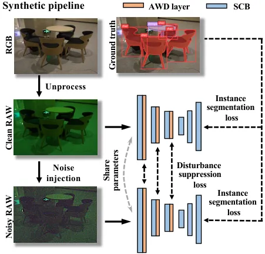
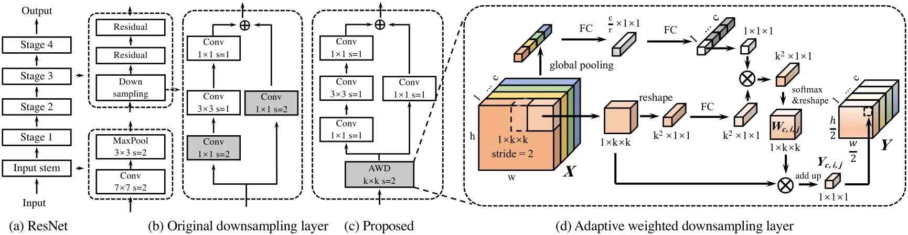
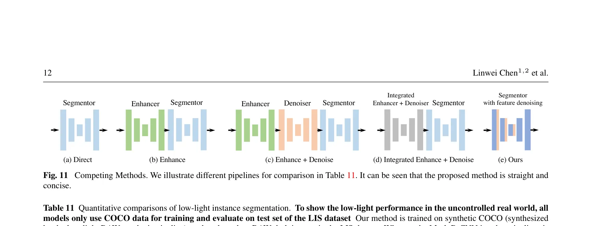

# Instance Segmentation in the Dark

- **来源**: https://arxiv.org/abs/2304.14298
- **本地PDF**: `../raw/2023-04-27-inssegdark.pdf`
- **本地LaTeX**: `../raw/2023-04-27-inssegdark-latex/`
- **参考链接**: https://www.cs.princeton.edu/~fheide/papers/instance_segmentation_in_the_dark.pdf（Princeton 作者页 PDF）；https://doi.org/10.1007/s11263-023-01808-8（IJCV 期刊 DOI）；https://github.com/Linwei-Chen/LIS（官方代码）
- **公众号/知乎推文**: [知乎：Instance Segmentation in the Dark 解读（Uno Whoiam）](https://zhuanlan.zhihu.com/p/656570195)；[顶刊IJCV 2023!北理工&普林斯顿提出:暗光实例分割](http://mp.weixin.qq.com/s?__biz=MzUxNjcxMjQxNg==&mid=2247582385&idx=2&sn=7df7a6dacc778246e9249ac3a33acecb)（微信公众号“CVer”，转载知乎）；[顶刊IJCV2023分割可卷的新方向&新数据集!在暗光条件下进行实例分割](http://mp.weixin.qq.com/s?__biz=MzI5MDUyMDIxNA==&mid=2247656029&idx=1&sn=8d0a5e9f060fe155da2cc8b525676db3)（微信公众号“极市平台”，转载知乎）
- **日期**: 2023-04-27
- **标签**: `instance-segmentation` `low-light` `raw-image` `feature-denoising` `awd` `scb` `dsl` `lis-dataset` `ijcv2023`
- **研究方向**: 计算机视觉 → 实例分割（Instance Segmentation）→ 极低光 / RAW 域实例分割
- **作者**: Linwei Chen, Ying Fu, Kaixuan Wei, Dezhi Zheng, Felix Heide（北京理工大学；普林斯顿大学；麦吉尔大学；Algolux）
- **提交日期**: 2023-04-27 (v1)；2023-09-08 (v2)
- **会议/期刊**: International Journal of Computer Vision (IJCV)
- **代码**: https://github.com/Linwei-Chen/LIS
- **项目主页**: 无独立主页（代码与数据集见上）

---

## 摘要

**问题**: 现有实例分割方法主要面向高可见度输入，在极低光环境下性能显著下降。暗光图像的噪声会在神经网络特征图里引入高频扰动，削弱深层特征的语义响应。

**方案**: 提出三种抑制「特征噪声」的方法：自适应加权下采样层 AWD、平滑导向卷积块 SCB、扰动抑制学习 DSL。同时用 14 位 RAW 输入替代 8 位 sRGB，并靠低光 RAW 合成管线生成逼真训练数据。

**关键创新/贡献**：
- **创新点1（AWD）**: 把 ResNet 里步长为 2 的下采样换成内容感知的低通滤波，逐位置逐通道预测权重，在抑制高频噪声的同时保留边缘细节。
- **创新点2（SCB）**: 给普通 3×3 卷积加一条平滑导向分支，训练时学习平滑核，推理时重参数化回普通卷积，不增加推理开销。
- **创新点3（DSL）**: 让网络在干净图与带噪图上提取一致的特征，最小化两者特征图的欧氏距离，学到扰动不变特征。
- **创新点4（LIS 数据集 + RAW 合成管线）**: 采集 2230 对低光/正常光真实图像并标注实例级像素标签；用 unprocessing + 物理噪声模型从现有 sRGB 数据集合成低光 RAW。

**验证**: 在 LIS 测试集上，方法无需任何图像预处理，Mask R-CNN 基线下 AP 达 **31.8**，比 SID（27.2）高 **4.6 AP**，比直接预测（19.8）高 12.0 AP；推理速度 53.1 FPS，接近原 Mask R-CNN（Table 11）。

---

## 1. 引言

**背景 & 动机**:
- 实例分割同时做目标检测与语义分割的实例级输出，支撑机器人、自动驾驶等应用。
- 深度学习方法在正常光下表现很好，但暗光下细节被严重噪声「埋没」，性能急剧退化。
- 常见做法是给实例分割模型前面接图像增强/去噪模块。但额外恢复过程增加计算量与延迟，且极端低光下这些算法只能恢复有限信息，因为 8 位 sRGB 输出已经永久丢失了细节。
- 作者的两个关键观察：一是低光噪声在特征图里产生高频「feature noise」，导致深层语义响应变弱；二是高 bit-depth 的 RAW 比 8 位 sRGB 保留更多暗部场景信息。

**本文贡献**:
1. 提出 AWD、SCB、DSL 三个组件，抑制暗光带来的特征噪声，且都 model-agnostic、轻量甚至零推理开销。
2. 用 RAW 输入，并靠低光 RAW 合成管线从现有 sRGB 数据集生成逼真低光 RAW，实现端到端训练。
3. 采集并标注 LIS 数据集，覆盖 2230 对低光/正常光图像与实例级像素标签，作为暗光实例分割基准。

---

## 2. 相关工作

- **正常光实例分割**: 主流方法分两阶段（Mask R-CNN、HTC，基于 Faster R-CNN）与单阶段（YOLACT、BlendMask、CenterMask），多在正常光下设计，忽视低光。
- **暗光实例分割**: 目前研究较少。直接方案是把低光增强（SID、EnlightenGAN、Zero-DCE 等）或去噪（SGN 等）作为预处理。
- **低光分类/检测**: QIS 用学生-教师学习分类带噪量子图像；Anscombe 网络做轻量 ISP；YOLO-in-the-dark 用 glue layer 把 SID 与 YOLO 拼起来。它们没考虑更难的暗光实例分割。
- **低光合成**: 增强方法常需低光/正常光配对，难以获取；一些工作用零参考或无配对训练，或用 Retinex-Net、GLADNet 从正常光图合成低光。但这些只考虑简单高斯/泊松噪声，且不能从 sRGB 合成低光 RAW。本文用 unprocessing + 物理噪声模型解决。
- **低光数据集**: 夜间检测、语义分割数据集存在，但噪声水平低，且缺实例级像素标签，不适合实例分割。本文采集 LIS 补齐这一空缺。

---

## 3. 低光分割学习

方法整体思路：先指出「特征噪声」是暗光实例分割退化的关键，再用 RAW 合成管线造数据，最后用 AWD、SCB、DSL 三个组件在特征层面抑制噪声。总览见下图。

*图 1：方法总览。AWD、SCB 与 disturbance suppression loss 用于降低噪声带来的特征扰动，低光 RAW 合成管线用于支持 RAW 输入的端到端训练（论文 Figure 3）。*

### 3.1 动机

- RAW 因更高 bit-depth，有更好潜力恢复暗部信息，但采集低光 RAW 实例分割数据集费时费力，最好能利用现有正常光 sRGB 数据集。作者用 unprocessing + 噪声注入来合成低光 RAW。
- 作者观察：低光噪声会扰动预测，解决这种退化通常带来额外计算量（如前置增强/去噪）。为避免这个开销，作者不降噪图像，而是降噪特征，即在网络内部抑制特征图里的高频扰动。

### 3.2 低光 RAW 合成管线

管线分两步：

**Unprocessing**。sRGB 由 RAW 经过 ISP 的一系列变换（色调映射、伽马校正、颜色校正、白平衡、去马赛克）得到。借助 unprocessing 反转这些变换，就能从 sRGB 得到 RAW，零成本造 RAW 数据集。

**Noise injection**。得到干净 RAW 后，要注入噪声模拟真实带噪低光图。作者不用常用的泊松-高斯（异方差高斯）噪声模型，而用更精确的物理噪声模型，它同时刻画光子散粒噪声、读出噪声、banding（行）噪声与量化噪声，能更准确还原真实噪声结构。

### 3.3 自适应加权下采样层 AWD

**出发点**。ResNet 的 downsampling 用步长为 2 的 1×1 卷积实现，只取单个像素，类似最近邻插值，对抑制噪声无用。作者先用低通滤波器（高斯、均值、双边）做下采样，能抑制噪声（Table 1 里扰动指标下降、AP 上升），但这些固定滤波器会模糊边缘纹理，且不同空间位置信号频率不同，需要逐位置不同滤波。

**空间变体 → 通道变体**。作者先提出空间变体滤波器，再指出不同通道在同一位置对图像特征的语义响应不同、频率也不同，且局部生成权重没用上全局信息。于是 AWD 同时利用局部特征 $V$ 与全局池化特征 $T$，预测逐通道逐位置的低通滤波核：

$$
Y_{c,i,j} = \sum_{p,q\in S} W_{c,i,j}^{p,q} \cdot X_{c,i+p,j+q},
$$

$$
V_{c,i,j} = \phi(X_{\Psi_{c,i,j}}),\quad T_c = \phi'(\mathrm{GP}(X)),
$$

$$
W_{c,i,j}^{p,q} = \frac{\exp(V_{c,i,j}^{p,q} \cdot T_c)}{\sum_{p,q\in S}\exp(V_{c,i,j}^{p,q} \cdot T_c)}.
$$

其中 $\mathrm{GP}$ 是全局池化，$T_c$ 类似 softmax 的温度参数，调节每个通道滤波核的平滑程度。用 softmax 约束权重为正且和为 1，保证生成的是低通滤波。

*图 2：自适应加权下采样 AWD 示意。原 ResNet 用步长为 2 的卷积下采样，只利用 1/4 的空间特征；AWD 自适应聚合周围全部特征，得到特征噪声更少的下采样结果（论文 Figure 4）。*

**消融**：Table 1 中 AWD 在各类低通滤波中扰动最低、AP 最高（39.3，比 None 高 1.3）；Table 6 显示 3×3 核最佳；Table 5 显示全局池化分支有效；Table 7 显示 AWD 与 CBAM/SE/non-local 正交，叠加后仍稳定增益。

### 3.4 平滑导向卷积块 SCB

SCB 给普通 3×3 卷积加一条辅助分支：先过一个可学习的 smooth-oriented 卷积（用均值或高斯核初始化、softmax 约束为正且和为 1），再接 1×1 卷积把平滑特征融合回主分支。训练时是线性组合的多分支结构，推理时用重参数化技巧折叠回单个 3×3 卷积：

$$
W'_{3\times3}[i,j,h,t] = W_{3\times3}[i,j,h,t] + \left(W_{1\times1}[i,j,1,1] * W_{\mathrm{SConv}}[i,1,h,t]\right).
$$

这样推理零额外开销。Table 8 显示可学习的 SConv（39.9 AP）优于固定的高斯/均值平滑核（39.4）。

### 3.5 扰动抑制学习 DSL

理想情况下，鲁棒网络无论输入是否被噪声污染都应提取相似特征。DSL 在训练时额外最小化干净特征与带噪特征的欧氏距离。总损失为：

$$
L(\theta) = L_{\mathrm{IS}}(x;\theta) + \alpha\,L_{\mathrm{IS}}(x';\theta) + \beta\,L_{\mathrm{DS}}(x,x';\theta),
$$

$$
L_{\mathrm{DS}}(x,x';\theta) = \sum_{i=1}^{n}\left\lVert f^{(i)}(x;\theta) - f^{(i)}(x';\theta)\right\rVert_2^2.
$$

其中 $x$ 是未处理的干净合成 RAW，$x'$ 是它的带噪版本，$f^{(i)}$ 是第 $i$ 个 stage 的特征图，经验上设 $\alpha=1$、$\beta=0.01$。$L_{\mathrm{IS}}$ 是实例分割损失（分类 + 框回归 + 分割逐像素分类），干净图与带噪图都参与。

DSL 与 perceptual loss 的区别在于：不需要预训练教师模型，且干净图与带噪图都由同一模型前向，避免了教师-学生之间的特征分布域差距。Table 9 显示 DSL 在 RAW-dark 上 +0.9 AP、RAW-normal 上 +1.9 AP，均优于 perceptual loss。

---

## 4. 低光实例分割数据集 LIS

用 Canon EOS 5D Mark IV 采集。特点：

- **成对样本**：每场景提供四种图像，即短曝光低光的 sRGB-dark 与 RAW-dark、长曝光正常光的 sRGB-normal 与 RAW-normal。相机固定在三脚架、手机远程控制，保证像素级对齐。
- **场景多样**：2230 对图像，覆盖室内外；用多档 ISO（800/1600/3200/6400）拍长曝光参考，用多档低光系数（10/20/30/40/50/100）缩短曝光模拟极低光。
- **实例级像素标签**：专业标注者标注，共 10504 个实例，8 类常见物体（自行车、汽车、摩托车、公交车、瓶子、椅子、餐桌、电视）。

---

## 5. 实验

### 5.1 实现细节

- 基线：Mask R-CNN + ResNet-50-FPN，基于 MMDetection。
- 输入：demosaicked 的三通道 RAW-RGB（把 Bayer 里两个绿像素平均得到绿通道），而非 4 通道 Bayer；14 位。
- 训练：合成 RAW-RGB 由 COCO（只用 LIS 的 8 类）经低光 RAW 合成管线生成；随机翻转增广；batch 8、lr 1e-2、12 epoch，第 8、11 epoch 各降 10 倍；用 COCO 预训练模型初始化。
- 评测：LIS 共 2230 对，随机分 1561 对训练、669 对测试；COCO 式 AP/AP50/AP75 与 APbox；FPS 在 600×400 图、单张 RTX 3090 上测。

### 5.2 消融研究

**sRGB vs RAW（Table 2、Table 4）**：正常光下 sRGB 与 RAW 上限接近，但线性 RAW-normal（45.4）比 sRGB-normal（48.1）低，原因是伽马校正让 sRGB 视觉更亮；对 RAW-normal 做伽马校正后回升到 48.1。低光下 RAW-dark（39.0）明显高于 sRGB-dark（35.5）。Table 4 显示 8→14 位性能单调上升，sRGB-dark 从 35.5 到 38.7、RAW-dark 从 35.5 到 39.0，说明高 bit-depth 是低光关键。

**低光 RAW 合成管线（Table 2）**：在合成 LIS 数据上，unprocessing 单独 +2.2 AP、噪声注入单独 +3.5 AP，二者结合从 31.6 提到 38.0，接近真实 RAW-dark 的 39.0；合成 COCO 上趋势一致（23.2→29.4）。

**AWD/SCB/DSL（Table 3）**：合成 LIS 下 baseline 38.0 → +AWD 39.3 → +AWD+SCB 39.9 → +AWD+SCB+DSL 40.8；真实 LIS 下 baseline 39.0 → 41.0 → 41.5 → 42.7。三者都正向贡献，且开销极小（GFlops 109.95→110.25，参数 43.78M→44.65M）。

**正常光（Table 10）**：COCO 上 Mask R-CNN 34.4 → +AWD+SCB+DSL 36.1，说明组件对正常光也有益。

### 5.3 方法对比

主对比（Table 11）所有模型只用 COCO 训练、在 LIS 测试集评测。直接预测的 Mask R-CNN 仅 19.8 AP；增强后再去噪的 Zero-DCE+SGN 为 26.5 AP；能恢复 RAW 的 SID 为 27.2 AP。本文端到端方法达 31.8 AP，且无需任何预处理，推理 53.1 FPS，接近原 Mask R-CNN 的 56.2 FPS。

*表 1：低光实例分割的主对比（论文 Table 11）。所有模型只用 COCO 训练、在 LIS 测试集评测；本文用合成 COCO 训练，其他管线用 COCO 原图训练、在增强后的 sRGB 上评测。*

### 5.4 LIS 数据集微调

所有方法可访问 LIS 训练集微调（Table 12）。直接 RAW 训练达 39.0 AP；联合优化 U-Net+Mask R-CNN 达 39.2 AP；本文达 42.7 AP，且推理更快。说明 LIS 数据对低光任务重要，且本文方法在微调后仍领先。

### 5.5 不同实例分割模型

方法 model-agnostic。PointRend 上本文 32.8 AP、Mask2Former 上 35.6 AP，均超过增强+去噪管线与 SID（Table 14）。

### 5.6 不同骨干

Swin-T 上本文 32.6 AP、ConvNeXt-T 上 36.8 AP，均一致领先（Table 13）。注意 SCB 不适用于 Transformer 骨干 Swin，但 AWD 与 DSL 仍有效。

### 5.7 扩展到低光目标检测

用 Faster R-CNN 做低光目标检测，本文 36.3 APbox，优于 Zero-DCE+SGN（30.5）与 SID（30.1）（Table 15），说明方法与数据集可迁移到检测。

---

## 6. 结论

**总结**: 本文探索了 RAW 上的端到端极低光实例分割。为对抗暗光退化，提出 AWD、SCB、DSL 处理噪声带来的特征噪声，分别在下采样、卷积运算、特征学习阶段降低特征扰动、学习扰动不变特征。方法以极小计算开销大幅领先 SOTA。同时采集 LIS 数据集，含 2230 对低光/正常光图像与实例级像素标签，可作为暗光高层视觉任务基准。

**局限**: 论文未设专门局限小节，从方法与实验可归纳：
- 依赖目标相机的噪声参数（Canon EOS 5D Mark IV）做 RAW 合成，换相机需重新标定。
- 输入是 demosaicked 的 RAW-RGB 而非原始 Bayer，仍含一定预处理。
- 只覆盖 8 类常见物体，类别数有限。
- SCB 依赖卷积结构，无法直接用于 Swin 等 Transformer 骨干。

---

## 本文涉及到的模型具体结构

| 模块 | 结构 | 说明 |
|---|---|---|
| 基线 | Mask R-CNN + ResNet-50-FPN | MMDetection 实现 |
| 输入 | 3 通道 RAW-RGB（14 位，demosaicked）| 绿通道由两绿像素平均得到 |
| AWD | AdaDConv | 替换步长 2 下采样，逐通道逐位置预测 softmax 低通核 |
| SCB | SmoothPriorBottleneck | 3×3 主分支 + 1×1+smooth-oriented 辅助分支，推理时重参数化 |
| DSL | MaskRCNNNoiseInv | 干净/带噪双前向 + 特征一致性损失 |
| 噪声模型 | PGRU 物理噪声 | 光子散粒 + 读出 + banding + 量化噪声 |

---

## 实验的全部流程

### 数据准备
1. 用 Canon EOS 5D Mark IV 采集 2230 对低光/正常光图像，四种类型 sRGB/RAW × dark/normal。
2. 专业标注者标注 8 类、10504 个实例的像素级标签。
3. 用 unprocessing 把 COCO（8 类）sRGB 反转成 RAW，再用 PGRU 物理噪声模型注入噪声，合成低光 RAW-RGB 训练数据。

### 训练
4. 合成 RAW-RGB 输入 Mask R-CNN，随机翻转增广，COCO 预训练初始化。
5. DSL 下做干净图与带噪图双前向，实例分割损失两边都算，再加特征扰动抑制损失。
6. AWD 在下采样处预测低通核，SCB 训练时多分支、推理时折叠。
7. batch 8、lr 1e-2、12 epoch，第 8、11 epoch 降 10 倍。

### 测试
8. LIS 669 张测试图，评测 AP/AP50/AP75 与 APbox、FPS。
9. 对比直接预测、增强、增强+去噪、RAW 恢复、联合优化等管线。
10. 扩展到 PointRend、Mask2Former、Swin-T、ConvNeXt-T、Faster R-CNN。

---

## 个人评价

**核心价值**: 这篇论文把「暗光实例分割」这个方向立起来了，核心贡献不在分割头，而在三件事：一是**定位问题**（噪声→特征噪声，而非单纯图像噪声）；二是**特征级降噪**（AWD/SCB/DSL 都在特征层面动手，零/极小推理开销）；三是**数据闭环**（RAW 合成管线 + LIS 真实基准）。它证明暗光视觉任务里「数据像不像真的」和「在特征而非图像上处理」往往比堆大模型更有效。

**可借鉴点**:
- **RAW 优先 + bit-depth 分析**：14 位 RAW 在低光下显著优于 8 位 sRGB，且 Table 4 把 bit-depth 单拎出来做消融，这条结论对遥感夜间、车载夜视、手机极暗光场景都适用。
- **特征噪声建模**：把「图像降噪」换成「特征降噪」，用扰动指标定量衡量，是低层视觉与高层任务结合的好范式。
- **AWD 的 softmax 低通核**：逐通道逐位置、正权重和为 1，保证低通，又能保留边缘，是很轻量通用的下采样改进，可迁移到任何 CNN 骨干。
- **SCB 的重参数化**：训练时多分支、推理时折叠，零成本提升鲁棒性，工程上很实用。
- **DSL 的干净/带噪一致性**：不需要教师模型，比 perceptual loss 更简洁，且能同时用干净与带噪图。
- **合成管线 + 真实基准**：unprocessing + 物理噪声造训练数据，再配一个真实成对数据集验证，是可复用的「数据方法」。

**实验设计亮点**:
- sRGB vs RAW、不同 bit-depth、合成 vs 真实逐层拆解，证据链完整。
- 与增强、增强+去噪、RAW 恢复、联合优化四类管线对比，且统一只用 COCO 训练测零样本低光，公平。
- 扩展到 PointRend、Mask2Former、Swin-T、ConvNeXt-T、Faster R-CNN，验证 model-agnostic。
- 报 FPS 与 GFlops/参数，说明精度与效率兼顾。

---

## 疑问解答 (Q&A)

### Q1: 为什么不在 sRGB 上做，而要上 RAW？

**答**：低光下 8 位 sRGB 输出已经永久丢失暗部细节（椅背结构都看不清），而 14 位 RAW 保留了更多信息。Table 4 显示 bit-depth 是低光性能的关键，8 位到 14 位 AP 单调上升。RAW 的噪声也更简单、更接近传感器物理，更好建模。

### Q2: AWD 与普通下采样、与注意力机制有什么本质区别？

**答**：普通步长卷积下采样只取单个像素，对噪声无用；AWD 预测逐通道逐位置的低通核，用 softmax 保证正权重和为 1，抑制高频噪声又保留边缘。与注意力机制不同，AWD 作用于下采样操作、动机来自低通滤波，与 CBAM/SE/non-local 正交，所以能稳定叠加（Table 7）。

### Q3: SCB 推理时怎么做到零开销？

**答**：训练时 SCB 是 3×3 主分支 + 1×1+smooth-oriented 辅助分支的线性组合，推理时用重参数化把两条分支的卷积核相加，折叠回单个 3×3 卷积，因此推理参数与计算量与普通卷积完全一致。

### Q4: DSL 和 perceptual loss 有什么区别？

**答**：perceptual loss 用预训练教师模型提取干净图特征去监督带噪图的学生，需要预训练教师，且学生只看到带噪图、教师学生间有特征分布域差。DSL 用同一个模型分别前向干净图与带噪图，直接最小化两者特征欧氏距离，更简单，且干净图与带噪图都参与实例分割损失。Table 9 中 DSL 在 RAW-dark 上 +0.9、RAW-normal 上 +1.9，优于 perceptual loss。

### Q5: 主结果 31.8 AP 是在什么设定下得到的？

**答**：Table 11 的公平设定是「所有方法只用 COCO 训练、在 LIS 测试集评测」。本文用合成 COCO 训练并在 RAW-dark 上评测；其他管线用 COCO 原图训练、在增强后的 sRGB 上评测。直接 Mask R-CNN 19.8、Zero-DCE+SGN 26.5、SID 27.2，本文 31.8。若开放 LIS 训练集微调，本文达 42.7 AP（Table 12）。

### Q6: 官方代码与论文有哪些不一致？

**答**：对照 `Linwei-Chen/LIS`，有几处轻微不一致，都在实现细节：
- DSL 损失：论文写纯欧氏距离，代码 `MaskRCNNNoiseInv` 里用 `clamp(MSE, max=0.1)`，即把逐像素 MSE 截断到 0.1。
- RAW-RGB 输入：论文脚注说绿通道由两绿像素平均得到，代码 `process()` 用 `cv2` 的 Bayer RG2RGB 去马赛克，不是简单平均。
- Bayer 顺序：代码 `mosaic()` 输出 RGBG 排列，与常见的 RGGB 不同，属内部细节。
- 复现数字：README 说论文的 31.8/37.6 在完整 669 图测试集测得；公开（隐私过滤后的）测试集给出 32.0/37.5，两者略有差异。

### Q7: LIS 数据集规模与构成？

**答**：2230 对图像，随机分 1561 对训练、669 对测试；每场景四种图（sRGB/RAW × dark/normal）；8 类、10504 个实例。用 Canon EOS 5D Mark IV 采集，多档 ISO 与低光系数模拟极低光。

### Q8: 主要局限？

**答**：依赖 Canon 5D4 的噪声参数做合成，换相机需重新标定；输入是 demosaicked RAW-RGB 而非原始 Bayer；只覆盖 8 类；SCB 依赖卷积、不适用于 Swin 等 Transformer 骨干；论文未设专门局限小节。

---

## 相关推文（微信公众号/知乎）

- [知乎：Instance Segmentation in the Dark 解读（作者 Uno Whoiam）](https://zhuanlan.zhihu.com/p/656570195) — 知乎专栏，官方 README 亦引用此链接。
- [顶刊IJCV 2023!北理工&普林斯顿提出:暗光实例分割](http://mp.weixin.qq.com/s?__biz=MzUxNjcxMjQxNg==&mid=2247582385&idx=2&sn=7df7a6dacc778246e9249ac3a33acecb) — 微信公众号“CVer”，转载自上述知乎。
- [顶刊IJCV2023分割可卷的新方向&新数据集!在暗光条件下进行实例分割](http://mp.weixin.qq.com/s?__biz=MzI5MDUyMDIxNA==&mid=2247656029&idx=1&sn=8d0a5e9f060fe155da2cc8b525676db3) — 微信公众号“极市平台”，转载自上述知乎。

> 以上链接来自搜索结果与官方 README，标题与公众号名以搜索结果为准。推文仅作传播线索，方法与数字均以论文原文和官方代码为准。

---

## 关联笔记

- [Unprocessing Images for Learned Raw Denoising](/readings/2018-11-27-unprocessing)：本文的低光 RAW 合成管线直接沿用其 unprocessing 思路，可对照两篇的「逆 ISP 造 RAW 数据」。
- [Grounding DINO: Marrying DINO with Grounded Pre-Training for Open-Set Object Detection](/readings/2023-03-09-groundingdino)：同属检测/分割方向，Grounding DINO 做开放词汇，本文做低光鲁棒，可对照不同任务难点。
